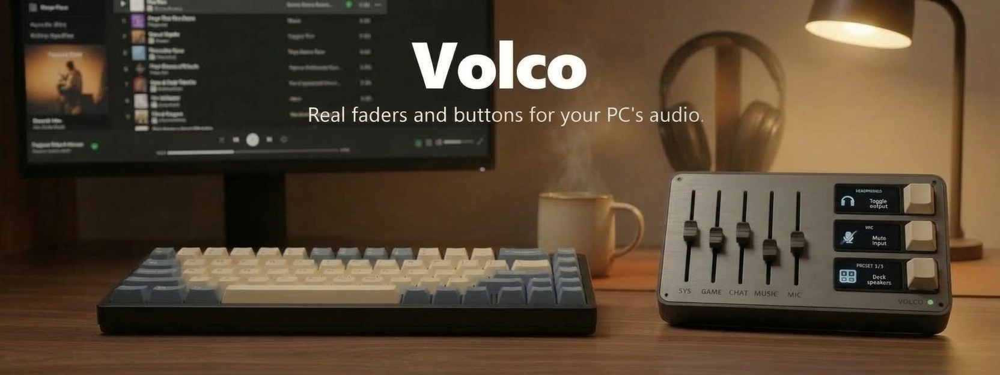
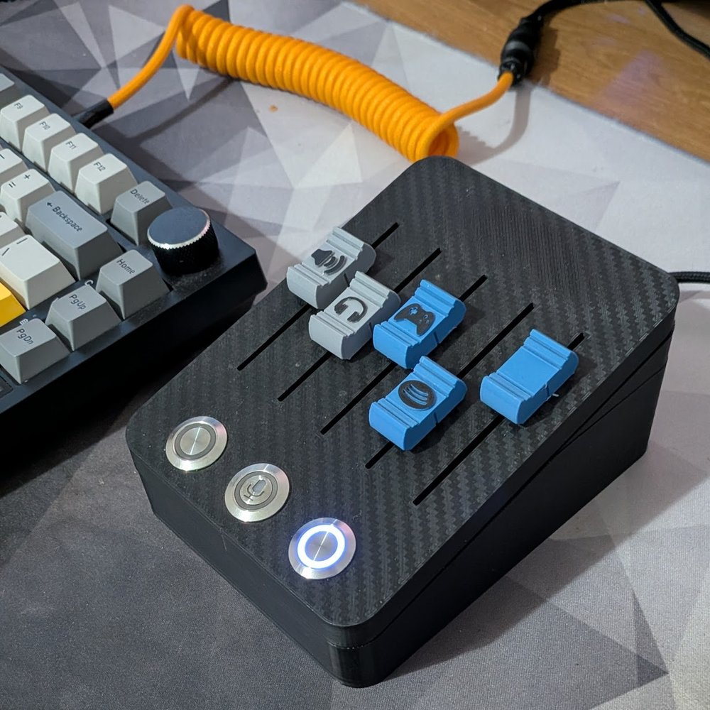
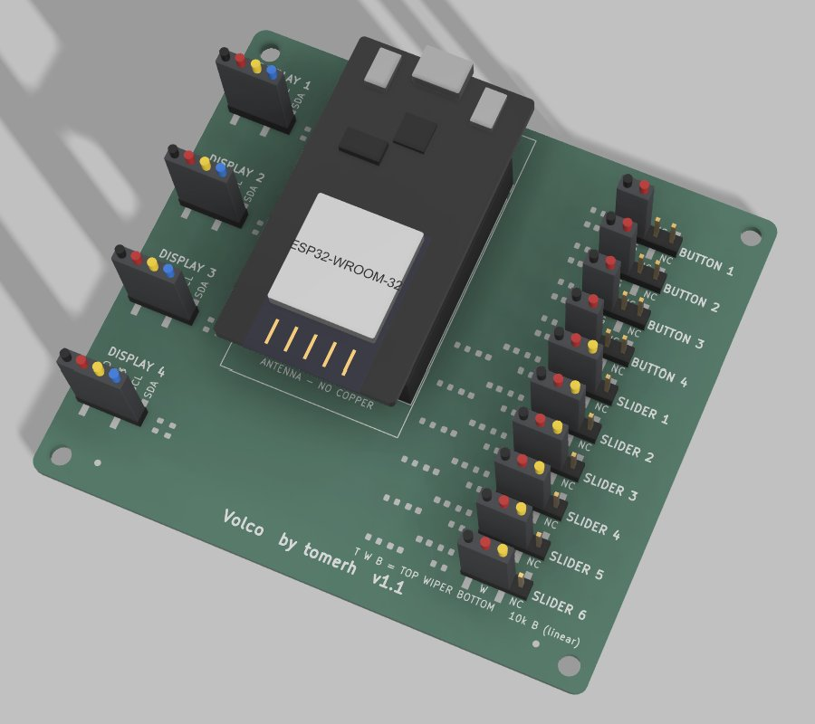
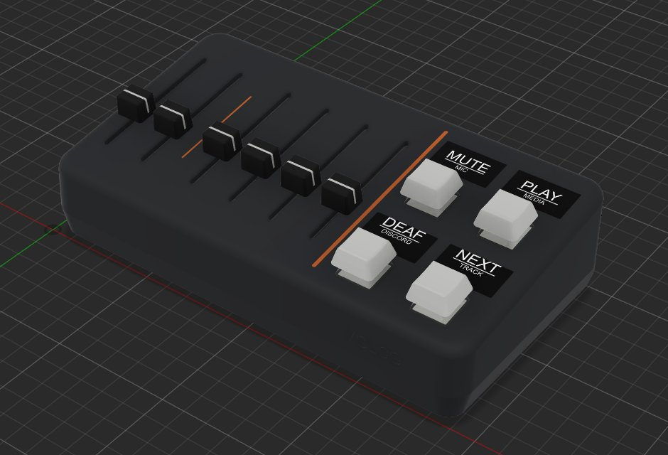
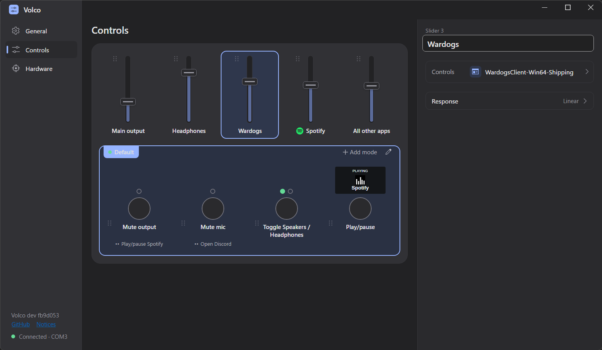
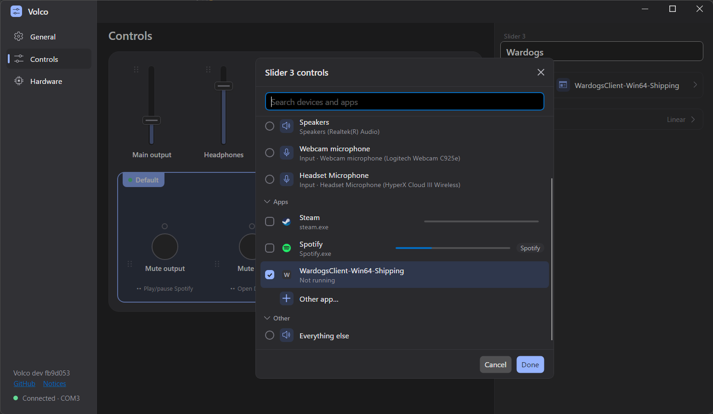
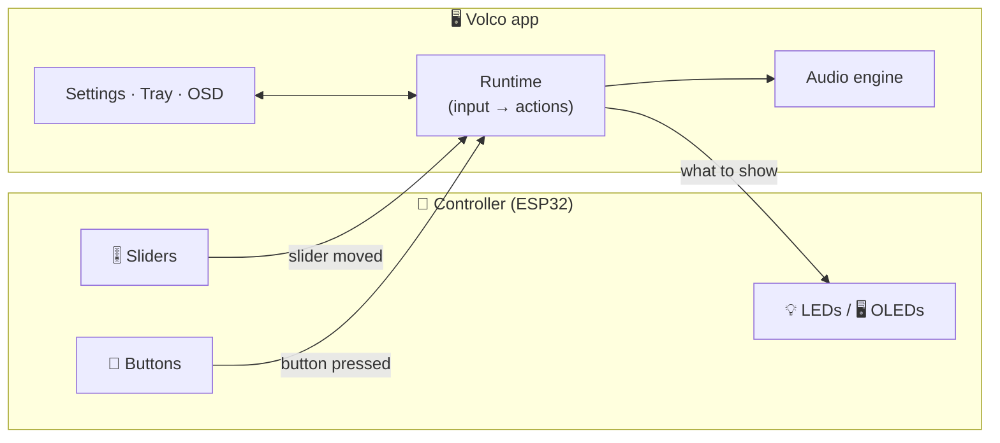

<div align="center">



<br>

**Real sliders and buttons for your PC's audio.**<br>
Spotify on one fader, your game on another, Discord on a third. Mute the mic, swap headphones for speakers, and see it all on the buttons.

<br>

[](https://github.com/ToMeRhh/volco/actions/workflows/build.yml)
[](https://github.com/ToMeRhh/volco/releases/latest)

[](LICENSE)
[](https://github.com/sponsors/ToMeRhh)

</div>

---

## 👋 Why I built this

About two years ago I built a [**deej**](https://github.com/omriharel/deej), the open-source Arduino volume mixer, and started making it my own. I added output device switching, mute buttons, and UDP support so it could run over Wi-Fi instead of a cable. Along the way I kept running into the limits of its design, and I wanted something else.

**Volco is that something else: a new project, built from the ground up.** A new architecture, and a dedicated two-way binary protocol, so state can be shown on LEDs and screens. The controller describes its own hardware, and all the logic lives in the app. **The firmware, the desktop app, the PCB, and the case** were all built for this project (the PCB and case files are coming soon).

Today it runs on **Windows**. The app is built so it can be ported to **macOS and Linux**: the UI is already cross-platform, and the OS-specific code sits behind a few small interfaces. Those ports haven't been written yet, and help is welcome.

> **Built with Claude Code.** I'm an experienced software engineer, and I built Volco with [Claude Code](https://claude.com/claude-code) as my pair programmer. I designed the architecture, reviewed every change and tested it on real hardware.

This is my first open-source project, so issues, ideas and feedback are very welcome. ❤️ If Volco is useful to you, you can support it through [GitHub Sponsors](https://github.com/sponsors/ToMeRhh).

## 📸 The hardware

<p align="center">
  
  <br><sub>My controller today: an ESP32, 5 sliders and 3 LED-ring buttons in a 3D-printed case</sub>
</p>

Next up is a custom PCB and a new case with an OLED screen above each button. Both are coming to this repo soon:

<table>
<tr>
<td width="50%" align="center"><br><sub>The custom PCB: ESP32, 6 sliders, 4 buttons, 4 screens</sub></td>
<td width="50%" align="center"><br><sub>The 3D-printed case (render)</sub></td>
</tr>
</table>

You don't need my board, though. Volco works with **any layout you wire up**: as many sliders and buttons as you have pins, and each button can have **no indicator, an LED, an LED pair, or a small OLED screen**. You describe the hardware in the app, and the controller stores it. There's nothing to change in the code.

> [!NOTE]
> **Coming from deej?** If your deej build runs on an **ESP32**, Volco can replace it in place: install the firmware from the app, enter your slider pins on the Hardware page, and keep your hardware as it is. (On an Arduino Uno or Nano, the firmware doesn't run yet.)

> [!TIP]
> **No hardware yet?** Open [`tools/simulator/index.html`](tools/simulator/) in a browser. It's a 3D simulated controller that connects to the app over WebSocket, so you can try everything first.

## ✨ What it does

|  |  |
|---|---|
| 🎛️ **Per-app volume** | A slider for `spotify.exe`, one for `discord.exe`, one for your game, or a group of apps |
| 🌐 **"Everything else"** | One slider for every app no other slider claims |
| 🔊 **Device volume** | A specific output device, or whatever the current default is |
| 🔇 **Mute** | The current output, the microphone, or a specific device |
| 🎧 **Output switching** | Toggle between headphones and speakers, or jump to a specific device |
| ⏯️ **Media keys** | Play/pause, next, previous and stop, for the current player or a specific app |
| 🚀 **Programs & scripts** | Open (or bring to front) a program, or run a `.bat`, `.ps1`, `.py` or `.js` script |
| 🔘 **Single, double & long press** | Up to three actions per button |
| 🗂️ **Modes** | Each button keeps its own actions per mode; switch modes from a button |
| 🖥️ **OLED button screens** | Icons, live status, scrolling names, Hebrew/RTL, synced slide animations, burn-in protection |
| 🏷️ **Device nicknames** | "Sony WH-1000XM5 Hands-Free AG Audio" becomes **Headphones** 🎧, on screen and on the controller |
| 🔧 **Firmware from the app** | Volco carries its matching firmware and installs or updates it over USB |
| 🔄 **Self-updating** | The app updates itself from GitHub Releases |

## 🖼️ The app

<table>
<tr>
<td width="50%" align="center"><a href="docs/images/app-controls.png"></a><br><sub><b>Controls:</b> your sliders and buttons as a drawing of the controller; pick one to set what it does</sub></td>
<td width="50%" align="center"><a href="docs/images/app-controls-dialog.png"></a><br><sub><b>Slider dialog:</b> devices, microphones and apps, with their icons and live levels</sub></td>
</tr>
</table>

<!-- TODO(Tomer): a screenshot of the volume OSD would go well here. -->

## 🚀 Getting started

1. **Build a controller.** Wire sliders (one ADC pin each) and buttons (one GPIO to GND each) to an ESP32. The [firmware guide](firmware/README.md) has the wiring notes and pin choices.
2. **Get the app.** Download `Volco.exe` from the [latest release](https://github.com/ToMeRhh/volco/releases/latest). It's a single file with nothing to install; run it and it appears in the system tray.
   > Volco isn't code-signed yet, so Windows SmartScreen may warn you the first time. Choose **More info → Run anyway**.
3. **Flash the firmware.** Plug the ESP32 in over USB, open **Settings → Controller**, pick its COM port and choose **Install firmware…**. It takes under a minute.
4. **Set it up.** On the same page, choose **Set up**, start from the **DIY reference** preset or your own layout, and **Save to controller**. Then map your sliders and buttons on the **Controls** page. Done! 🎉

Wi-Fi (UDP) is in the Hardware page's **Advanced** section. USB always stays on, so a wrong Wi-Fi setting can be fixed over the cable.

## 🧩 How it works



The firmware is deliberately simple. It doesn't know what "mute" or "headphones" mean: it reports *"slider 2 is at 3071"* and *"button 0 was pressed"*, and it draws whatever the PC sends back. All the logic lives in the app, so **changing what a button does never needs a reflash**.

They talk over a small, open binary protocol that works the same over **USB serial, UDP and WebSocket**. You can build your own controller (an RP2040, a phone app, a MIDI bridge...) and Volco will drive it. The byte-level spec is in [`firmware/README.md`](firmware/README.md#wire-protocol).

| Part | Where | Built with |
|---|---|---|
| 🖥️ App | [`src/`](src/) | C# / .NET 8, [Avalonia](https://avaloniaui.net/) UI, Windows Core Audio |
| 🧠 Firmware | [`firmware/`](firmware/) | C++17, PlatformIO / Arduino-ESP32 |
| 🎮 Simulator | [`tools/simulator/`](tools/simulator/) | Plain JavaScript and three.js, no build step |
| 🔌 PCB & case | *coming soon* | Custom ESP32 PCB, 3D-printed case |

## 🌍 Platforms

| Platform | Status |
|---|---|
| 🪟 Windows 10 / 11 | ✅ Supported |
| 🍎 macOS | 🚧 Not yet: designed for it, not implemented |
| 🐧 Linux (PipeWire / PulseAudio) | 🚧 Not yet: designed for it, not implemented |

The UI is already cross-platform: it's built with [Avalonia](https://avaloniaui.net/), and it and the core (`Volco.Core`, `Volco.App`) are platform-free and tested on Linux in CI. Everything that touches the OS sits behind a few small interfaces, implemented for Windows in `Volco.Windows`. A port is a new host project that implements them for macOS or Linux, mainly `IAudioEngine` (per-app and device volume), with no UI work. If you'd like to take one on, open an issue and let's talk.

## 🧑‍💻 Contributing

Contributions are welcome! [`CONTRIBUTING.md`](CONTRIBUTING.md) covers building, testing and the project's layout, and [`docs/design/`](docs/design/) has the design documents behind each subsystem. The short version:

```bash
dotnet test tests/Volco.Core.Tests        # app tests (any OS, .NET 10 SDK)
dotnet test tests/Volco.App.Tests
cd firmware && pio test -e native         # firmware tests on your PC
```

## 🗺️ Roadmap

- [x] Per-app and device volume, mute, output switching
- [x] Modes with single, double and long press actions
- [x] OLED button screens
- [x] Media, program and script actions
- [ ] 🔌 PCB files, BOM and case
- [ ] 🍎 macOS and 🐧 Linux support
- [ ] ✍️ A code-signed Windows build

## 🙏 Acknowledgements

- [**deej**](https://github.com/omriharel/deej) by Omri Harel, the project that got me started
- [Avalonia UI](https://avaloniaui.net/), [PlatformIO](https://platformio.org/) and the [Arduino-ESP32](https://github.com/espressif/arduino-esp32) core
- [U8g2](https://github.com/olikraus/u8g2), the SSD1306 driver
- [Arimo](https://fonts.google.com/specimen/Arimo), the screen font ([SIL Open Font License 1.1](firmware/assets/fonts/OFL.txt))

## 📄 License

Volco (the app, the firmware and the tools) is licensed under the [GNU General Public License v3.0](LICENSE). Third-party components keep their own licences; see [`THIRD-PARTY-NOTICES.txt`](THIRD-PARTY-NOTICES.txt).

<div align="center">
<br>
<sub>Made with 🎚️ and too many potentiometers.</sub>
</div>
