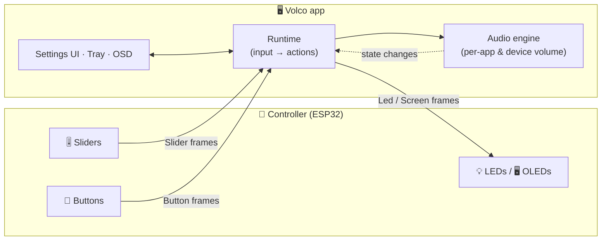
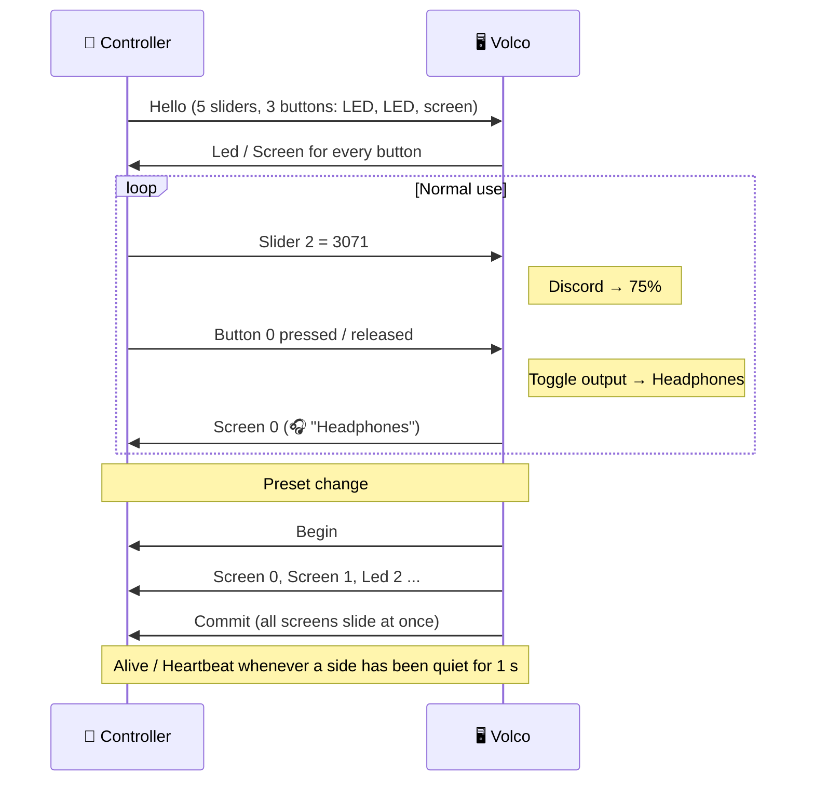

<div align="center">


<br>

**Turn a handful of sliders and buttons into a real mixing desk for your computer.**<br>
Spotify on one fader, your game on another, Discord on a third. Mute the mic, swap headphones for speakers, and see it all on the buttons.

<br>

[](https://github.com/ToMeRhh/volco/actions/workflows/build.yml)
[](https://github.com/ToMeRhh/volco/releases)


<!-- TODO: add a license badge once a LICENSE file exists, e.g.  -->

[**Overview**](#-what-is-volco) ·
[**The controller**](#-the-controller) ·
[**The firmware**](#-the-firmware) ·
[**The protocol**](#-the-protocol) ·
[**The app**](#-the-app) ·
[**Getting started**](#-getting-started) ·
[**Development**](#-development)

</div>

---

## 🎚️ What is Volco?

Your PC has one volume, buried in a menu. Your audio isn't one thing, though: there's the game, the call, the music, the stream, and the microphone. Volco gives each of them a **physical control**.

Volco has three parts:

<table>
<tr>
<td width="33%" valign="top">

### 🔌 The controller
An **ESP32** with as many sliders and buttons as you want to wire up. Each button can have a **LED**, a **LED pair**, or a small **OLED screen**. You decide the layout.

</td>
<td width="33%" valign="top">

### 🧠 The firmware
A small **C++ firmware** that reports raw input and draws whatever the PC asks for. It talks to the PC over **USB, Wi-Fi UDP or WebSocket** using an open binary protocol.

</td>
<td width="33%" valign="top">

### 🖥️ The app
A **tray app** that turns slider moves into per-app or device volume and button presses into actions. It sends back what each button should show. Built with **Avalonia**; cross-platform support is coming.

</td>
</tr>
</table>



**The split matters.** The firmware doesn't know what "mute" or "headphones" mean. It reports *"slider 2 is at 3071"* and *"button 0 was pressed"*, and it draws what the PC sends. All the logic (mappings, presets, actions, device names) lives in the app. **Changing what a button does never needs a reflash.**

### ✨ Highlights

|  |  |
|---|---|
| 🎛️ **Per-app volume** | Assign a slider to `spotify.exe`, `discord.exe`, a game, or a group of apps |
| 🌐 **"Everything else" slider** | One slider for every app that no other slider claims |
| 🔊 **Device volume** | Control a specific output, or whatever the current default device is |
| 📈 **Response curves** | Linear, logarithmic, exponential or S-curve per slider |
| 🔘 **Single, double & long press** | Up to three actions per button, in each preset |
| 🗂️ **Presets** | Every button keeps its own actions per preset; flip presets from a button |
| 🎧 **Output switching** | Toggle between headphones and speakers, or jump to a specific device |
| 🔇 **Mute anything** | The current output, the microphone, or a specific device |
| 🖥️ **OLED button screens** | Icon, status line and action name, scrolling long text, Hebrew/RTL, synced slide animations, burn-in protection |
| 🏷️ **Device nicknames & icons** | "Sony WH-1000XM5 Hands-Free AG Audio" becomes **Headphones** 🎧, in the app and on the controller |
| 🫧 **Volume OSD** | A small click-through on-screen volume pill |
| 🧩 **Any hardware layout** | The controller describes itself on connect, and the settings window adapts |
| 🔄 **Self-updating** | Built-in updater from GitHub Releases (or dev builds, if you like living on the edge) |

> [!NOTE]
> 📸 **Screenshots and photos coming soon.**
> <!-- TODO: add docs/images/hardware.jpg (the controller), docs/images/settings-sliders.png,
>      docs/images/settings-buttons.png and docs/images/osd.png, then replace this note with:
> <p align="center">
>    
> </p>
> -->

---

## 🔌 The controller

The reference build is an **ESP32** with **5 sliders and 3 buttons**: two buttons with a LED each and one with a LED pair (for "headphones / speakers"). That's only one possible layout. **Volco is built so you can design your own controller.**

<table>
<tr><th>Part</th><th>How it connects</th><th>Notes</th></tr>
<tr><td>🎚️ <b>Sliders</b> (any number)</td><td>One ADC pin each</td><td>Linear potentiometers, sampled every 10 ms, smoothed and dead-banded in firmware</td></tr>
<tr><td>🔘 <b>Buttons</b> (any number)</td><td>One GPIO to GND each</td><td>Debounced in firmware; single/double/long press is decided by the app</td></tr>
<tr><td>💡 <b>LED</b></td><td>One GPIO</td><td>On/off, active-high or active-low</td></tr>
<tr><td>💡💡 <b>LED pair</b></td><td>Two GPIOs</td><td>Shows A or B, e.g. which output device is active</td></tr>
<tr><td>🖥️ <b>OLED screen</b></td><td>I²C (2 buses × 2 addresses)</td><td>SSD1306 128×64, up to 4 screens</td></tr>
</table>

<!-- TODO: wiring diagram / schematic image, e.g. docs/images/wiring.png -->
<!-- TODO: bill of materials and enclosure files (STL/STEP), if/when they're published -->

### 🛠️ Make it yours

The whole hardware description is **two tables** in [`firmware/src/config.h`](firmware/src/config.h):

```cpp
// Analog sliders: one ADC pin per slider.
static constexpr uint8_t SLIDER_PINS[] = {33, 35, 32, 36, 34};

// Buttons: { input pin, indicator }.
static constexpr ButtonDef BUTTONS[] = {
    {4,  IND_SCREEN(0, 0x3C)},                // OLED on I²C bus 0
    {14, IND_LED(21, ACTIVE_LOW)},            // single LED
    {5,  IND_LED_PAIR(18, 19, ACTIVE_HIGH)},  // two LEDs: A / B
};
```

A control's **position in its table is its input number**, and the app lists the controls in the same order. Add a slider, swap a LED for a screen, add a fourth button: reflash once, and when the controller connects it sends a **Hello** describing its sliders, buttons and indicators. The settings window follows.

> [!TIP]
> No hardware yet? Open [`tools/simulator/index.html`](tools/simulator/) in a browser. It's a full **simulated controller** (LED or OLED variant) that connects to the app over WebSocket.

---

## 🧠 The firmware

`firmware/` is a **PlatformIO / Arduino** project in C++17. It's intentionally simple:

- 📥 **Reads** sliders (filtered, dead-banded) and buttons (debounced), and reports changes.
- 📤 **Renders** what the PC sends: LED values, and screen layouts with icon, status line and main text.
- 💓 **Keeps the link healthy**: keepalives, auto-reconnect, and a *"not connected"* screen when the PC goes away.
- 🖼️ **Draws screens** on its own 1-bit canvas (U8g2 is only the SSD1306 driver), with Arimo fonts, Hebrew/RTL support, scrolling for long names, slide transitions, dimming, pixel shift and auto-off.

Everything you'd want to tweak is a `#define` in `config.h`: the transport (`TRANSPORT_SERIAL`, `TRANSPORT_UDP`, `TRANSPORT_WEBSOCKET`), Wi-Fi credentials, pins, debounce, slider smoothing, screen brightness, scroll speed, burn-in timers and more.

The protocol, rendering and screen-state logic live in pure C++ libraries under [`firmware/lib/`](firmware/lib/) (`volco_protocol`, `volco_bidi`, `volco_screen_state`, `volco_render`). They are **unit-tested on your PC** with `pio test -e native`, and some golden frames are shared with the C# tests so both sides agree on every byte.

📖 Full guide: [`firmware/README.md`](firmware/README.md) covers configuration, wiring, pin choices and rendering.

---

## 📡 The protocol

The controller and the app speak a small, **open binary protocol**. It's the same over USB serial, UDP and WebSocket, so you can write your own controller (an RP2040, an Arduino, a phone app, a MIDI bridge...) and Volco will drive it.

```
 ┌──────┬────────┬──────┬──────────────┬──────────┐
 │ 0xAA │ length │ type │ body …       │ checksum │
 └──────┴────────┴──────┴──────────────┴──────────┘
   start  type+body  ↑ high bit = direction   XOR of type and body
```

| Type | Message | Direction | What it carries |
|:---:|---|:---:|---|
| `0x01` | **Hello** | 🔌 → 🖥️ | Protocol version, slider count, button count, each button's indicator kind |
| `0x02` | **Alive** | 🔌 → 🖥️ | Keepalive |
| `0x03` | **Slider** | 🔌 → 🖥️ | Slider index and 12-bit value (0–4095) |
| `0x04` | **Button** | 🔌 → 🖥️ | Button index and pressed / released |
| `0x81` | **HelloRequest** | 🖥️ → 🔌 | "Who are you?" |
| `0x82` | **Heartbeat** | 🖥️ → 🔌 | Keepalive |
| `0x83` | **Led** | 🖥️ → 🔌 | Button and LED value |
| `0x84` | **Screen** | 🖥️ → 🔌 | Button, transition, layout, top line, icon, flags, main text |
| `0x85` | **Begin** | 🖥️ → 🔌 | Hold incoming updates... |
| `0x86` | **Commit** | 🖥️ → 🔌 | ...then apply them all at once (every screen slides together) |

<details>
<summary><b>How a session goes</b></summary>

<br>



- The PC sends nothing to a controller until it has seen its **Hello**, then pushes the full state.
- Either side going quiet past the timeout resets the link; the controller shows *"not connected"*.
- Frames for the wrong indicator kind, or for an out-of-range button, are ignored.

The full byte-level spec (Screen body, behaviour rules) is in [`firmware/README.md`](firmware/README.md#wire-protocol).

</details>

---

## 🖥️ The app

Volco lives in the **system tray**. Click it to open the settings window:

| Page | What you do there |
|---|---|
| 🎚️ **Sliders** | Map each slider to apps, a device, "all other apps", or nothing; pick a response curve |
| 🔘 **Buttons** | Set single / double / long press actions per preset, with a live preview of the LED or screen |
| 🎧 **Devices** | Give your audio devices nicknames and icons, and see which controls use each one |
| 🔗 **Connection** | USB (port & baud), Wi-Fi UDP or WebSocket, with the ports to match your firmware |
| ⚙️ **General** | Updates, detailed logging and the log folder |

### Button actions

| Action | Description |
|---|---|
| 🔇 Mute current output | Toggle mute on the default output |
| 🎙️ Mute current input | Toggle mute on the default microphone |
| 🎯 Mute specific device | Toggle mute on a chosen device |
| 🔀 Toggle output device | Switch the default output between two devices (A ↔ B) |
| 📌 Set output device | Make a specific device the default output |
| ⏭️ Next preset | Make the next preset live |
| 🗂️ Switch to preset | Jump to a specific preset |

Presses are classified on the PC: **single** (release, then 300 ms with no second press), **double** (two presses within 300 ms) and **long** (held 500 ms; fires immediately).

### 🌍 Cross-platform: coming soon

The app is already built to be cross-platform:

- **`Volco.Core`**: protocol, input, config and orchestration, plain `net8.0`.
- **`Volco.App`**: the entire UI in **Avalonia 12**, platform-free (enforced by architecture tests).
- **`Volco.Windows`**: the *only* OS-specific piece: the Core Audio engine and a click-through window helper.

Today the Windows build is the one that ships. Porting Volco means implementing one interface, `IAudioEngine`, for the new OS.

| Platform | Status |
|---|---|
| 🪟 Windows 10 / 11 | ✅ Supported |
| 🐧 Linux (PipeWire / PulseAudio) | 🚧 Planned <!-- TODO: link tracking issue --> |
| 🍎 macOS | 🚧 Planned <!-- TODO: link tracking issue --> |

---

## 🚀 Getting started

### 1. Build the controller

Wire your sliders, buttons and indicators to an ESP32, then describe them in [`firmware/src/config.h`](firmware/src/config.h). See [the firmware guide](firmware/README.md) for wiring notes.

### 2. Flash the firmware

```bash
cd firmware
pio run -t upload        # build & flash (needs PlatformIO Core >= 6.1.19)
pio device monitor       # optional: watch the serial log
```

### 3. Install the app

Download **`Volco.exe`** from the [latest release](https://github.com/ToMeRhh/volco/releases/latest). It's a single self-contained file with nothing to install. Run it and it appears in the tray.

<!-- TODO: winget / Scoop / installer instructions, once available -->

### 4. Connect & configure

Open the tray icon → **Connection**, pick **USB cable** (or Wi-Fi UDP / WebSocket, to match your firmware), and the controller's sliders and buttons appear in the settings window. Map them, and you're done. 🎉

> [!IMPORTANT]
> The repository is currently **private**, so the in-app updater needs a GitHub Personal Access Token (`repo` read scope, plus `actions:read` for dev builds). Enter it in **General → Updates**; it's stored only in your local `config.json`.

---

## 🧑‍💻 Development

<details>
<summary><b>🏗️ Architecture</b></summary>

<br>

```
Controller (ESP32: sliders, buttons, LEDs / OLED screens)
    ▲  │
    │  │  Binary protocol over Serial / UDP / WebSocket
    │  ▼
┌──────────────────────────────────────────┐
│  Communication                           │
│  Serial / Udp / WebSocketConnection      │
│  ├─ ProtocolParser  (controller → app)   │
│  └─ ProtocolEncoder (app → controller)   │
├──────────────────────────────────────────┤
│  Runtime: VolcoRuntime                   │
│  ├─ ControllerLink (Hello, keepalive,    │
│  │    deduplicated, ordered sends)       │
│  └─ ControllerDisplay (LED / screen per  │
│       button, from the live preset)      │
├──────────────────────────────────────────┤
│  Input                                   │
│  ├─ SliderProcessor (ADC → volume)       │
│  └─ ButtonPressDetector                  │
│     └─ ActionFactory → IButtonAction     │
├──────────────────────────────────────────┤
│  Audio: IAudioEngine                     │
│  └─ Windows: AudioEngine (Core Audio,    │
│     event-driven DeviceRegistry and      │
│     SessionRegistry, no polling)         │
├──────────────────────────────────────────┤
│  Config (JSON) + Avalonia UI             │
└──────────────────────────────────────────┘
```

Input flows down: frames become slider and button events, and presses run actions against the audio engine. Feedback flows up: audio, preset and config changes become LED values and screen descriptions pushed to the controller.

</details>

<details>
<summary><b>📁 Project structure</b></summary>

<br>

```
src/Volco.Core/        Platform-neutral core (net8.0): protocol, input, actions, config, runtime
src/Volco.App/         Avalonia UI (net8.0, platform-free): tray, settings pages, OSD, view models
src/Volco.Windows/     Windows host → Volco.exe: Core Audio engine, Win32 window effects

firmware/
├── src/               main, config.h (hardware tables), transports, indicators, screens
├── lib/               Pure C++ libs: volco_protocol, volco_bidi, volco_screen_state, volco_render
├── assets/            Icon PNGs and Arimo fonts
├── tools/             gen_assets.py (icons & fonts → C++, C#, JS)
└── test/              Native tests and golden frames shared with C#

tools/simulator/       Browser-based controller simulator (WebSocket)
tests/Volco.Core.Tests xUnit: parser, press detection, sliders, config, actions, runtime
tests/Volco.App.Tests  Avalonia headless: view models, pages, windows, OSD, architecture rules
docs/                  Specs, plans, checklists and mockups
```

</details>

<details>
<summary><b>🔨 Building & testing</b></summary>

<br>

**App:** needs the .NET 10 SDK (pinned in `global.json`; projects target .NET 8). The Windows exe must be built on Windows:

```bash
dotnet publish src/Volco.Windows/Volco.Windows.csproj -c Release -r win-x64 --self-contained true \
  -p:PublishSingleFile=true -p:IncludeNativeLibrariesForSelfExtract=true \
  -p:EnableCompressionInSingleFile=true -o ./publish/
```

The tests run on any OS:

```bash
dotnet test tests/Volco.Core.Tests
dotnet test tests/Volco.App.Tests
```

**Firmware:**

```bash
cd firmware
pio run                  # build
pio test -e native       # host-side tests of lib/
python3 tools/gen_assets.py   # regenerate icons & fonts (needs Pillow ≥ 10)
```

**CI** (`build.yml`) runs on every push and PR: C# tests on Ubuntu, firmware native tests plus ESP32 builds of every transport and the screens variant, and, on `main`, a Windows single-file build published as the `Volco-win-x64` artifact.

</details>

<details>
<summary><b>📦 Releases</b></summary>

<br>

Push a semver tag, or run the `release.yml` workflow from the Actions tab:

```bash
git tag v1.2.3 && git push origin v1.2.3
```

It builds a version-stamped `Volco.exe` and publishes a GitHub Release with generated notes. Release builds show **Check for Updates…** in the tray; the updater downloads the new exe and swaps it in place after the app exits.

</details>

<details>
<summary><b>⚙️ Configuration & logs</b></summary>

<br>

- Settings: `%APPDATA%/Volco/config.json`, applied as soon as you change them in the UI. It holds the connection, slider mappings, presets, per-preset button actions, device nicknames and icons, and the last hardware the controller reported (schema v4). Older configs are upgraded automatically.
- Log: `%APPDATA%/Volco/volco.log`

</details>

---

## 🗺️ Roadmap

- [x] Per-app & device volume, mute, output switching
- [x] Presets with single / double / long press actions
- [x] OLED button screens with icons, RTL text and synced transitions
- [x] Avalonia UI with a platform-free core
- [ ] 🐧 Linux & 🍎 macOS audio engines
- [ ] 📸 Photos, screenshots and a wiring diagram
- [ ] 🧰 Published hardware: BOM, schematic and enclosure <!-- TODO -->
- [ ] <!-- TODO: your next big idea -->

## 🙏 Acknowledgements

- [Avalonia UI](https://avaloniaui.net/): the cross-platform UI framework
- [PlatformIO](https://platformio.org/) and the [Arduino-ESP32](https://github.com/espressif/arduino-esp32) core
- [U8g2](https://github.com/olikraus/u8g2): SSD1306 driver
- [Arimo](https://fonts.google.com/specimen/Arimo): screen font, SIL Open Font License 1.1 ([`OFL.txt`](firmware/assets/fonts/OFL.txt))

## 📄 License

<!-- TODO: choose a license (e.g. MIT) and add a LICENSE file. -->
*License to be decided.*

<div align="center">
<br>
<sub>Made with 🎚️ and too many potentiometers.</sub>
</div>
